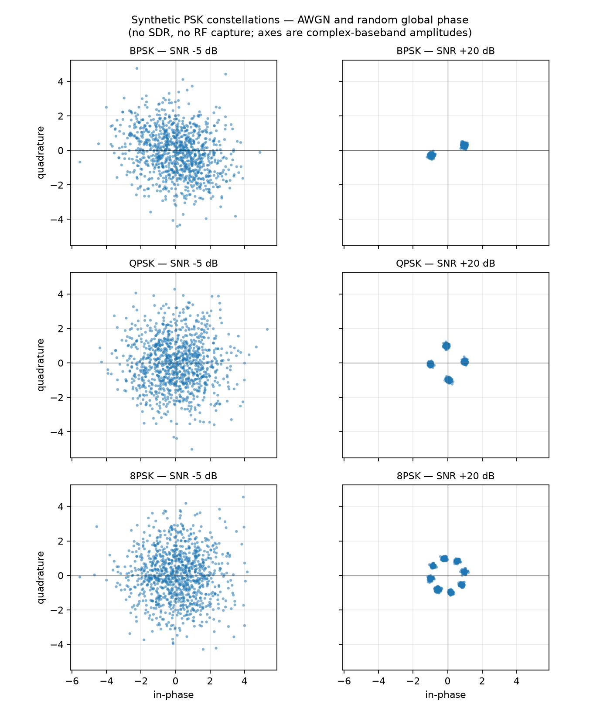

# synthetic-iq-modulation-classifier

> Classify synthetic BPSK, QPSK and 8-PSK signals from raw I/Q samples across SNR levels — a DSP and machine-learning pipeline with no SDR hardware.

**Status:** ✅ Completed — deterministic simulator, leakage-checked splits, Random Forest, per-SNR evaluation, CLI demo, tests and a measured synthetic benchmark.

> **Every signal in this project is simulated.** The numbers below describe this simulator only. They are not SDR, RF, field or hardware performance measurements.

## Results at a glance

Measured on the reserved test partition: **1,350 feature rows / scenarios**, 75 per class per SNR level. The test seeds and scenarios were not used for fitting or model selection.

| Model | Test accuracy | Test macro-F1 |
|---|---:|---:|
| Majority-class baseline (`bpsk`) | 0.3333 | 0.1667 |
| **Random Forest (44 features)** | **0.9593** | **0.9593** |

The review targets were met:

| Target | Measured on test |
|---|---|
| Macro-F1 ≥ 0.90 at SNR ≥ 15 dB | **1.0000 at +15 dB and +20 dB** |
| Macro-F1 ≥ 0.55 at −5 dB | **0.7600 at −5 dB** |

Per-SNR test results:

| SNR (dB) | Support | Random Forest macro-F1 | Majority baseline |
|---:|---:|---:|---:|
| −5 | 225 | **0.7600** | 0.1667 |
| 0 | 225 | **0.9956** | 0.1667 |
| +5 | 225 | **1.0000** | 0.1667 |
| +10 | 225 | **1.0000** | 0.1667 |
| +15 | 225 | **1.0000** | 0.1667 |
| +20 | 225 | **1.0000** | 0.1667 |

The remaining errors are concentrated at −5 dB, where QPSK and 8-PSK are confused: 27 QPSK windows were classified as 8-PSK and 27 8-PSK windows as QPSK. BPSK had 1.000 recall at every SNR level. At 0 dB only one 8-PSK window was misclassified. The full per-class recall and confusion matrices are in [`docs/evaluation.md`](docs/evaluation.md).

Validation, used for diagnostics and not fitting, produced overall macro-F1 **0.9481**; at −5 dB it was **0.6933** and at 0 dB **0.9956**. The test score is the held-out number reported above.

## Why this project exists

Automatic modulation classification is a compact way to show scientific Python: generate complex baseband signals, apply a channel model, extract features with signal-processing reasoning, train a classifier, and evaluate where the classes actually become hard. BPSK, QPSK and 8-PSK share a PSK family, so the difficulty is concentrated in phase resolution under noise — a good setting for honest per-SNR error analysis.

This is a new synthetic implementation. It does not inherit any previous accuracy claim; the README reports only what this pipeline measures.

## What it demonstrates

- Complex baseband signal generation and unit-average-power normalization.
- Oversampling with a documented zero-order-hold model.
- AWGN channel with random global phase and configurable SNR.
- Feature engineering: magnitude statistics, phase-difference statistics and phase histograms, at both sample and symbol-block rates.
- Leakage-safe splits with independent seeds per partition.
- Random Forest and a majority-class baseline.
- Evaluation broken down by SNR, with confusion matrices and representative errors.
- A CLI demo that classifies a freshly generated signal and saves a local figure.
- Reproducible data generation and a committed feature table for inspection.

## Signal model

- Symbols are complex baseband points normalized to unit average power.
- Each signal has 128 symbols with 8 samples per symbol (simple zero-order-hold oversampling).
- A random global phase, uniform in `[0, 2π)`, is applied to the whole signal.
- Complex AWGN is added after the phase rotation.
- No frequency offset, multipath, fading, timing error or IQ imbalance in the MVP.
- SNR is defined as average signal power divided by total complex noise power in the window.

| Parameter | Value |
|---|---|
| Classes | BPSK, QPSK, 8-PSK |
| Signals per class per SNR | 500 |
| SNR range | −5 to 20 dB, step 5 dB |
| Total scenarios | 9,000 |
| Symbols per signal | 128 |
| Samples per symbol | 8 |
| Samples per signal | 1,024 |

## Dataset and leakage checks

The default split is by independent scenario seeds, not by individual feature rows:

| Split | Scenarios per class per SNR | Total scenarios | Purpose |
|---|---:|---:|---|
| train | 350 | 6,300 | fit the model |
| validation | 75 | 1,350 | diagnostics only |
| test | 75 | 1,350 | final held-out evaluation |

Each split has its own master seed (`1042`, `2042`, `3042`). Every scenario derives a distinct signal seed from the split seed, class, SNR and index. The validator rejects duplicate scenarios, duplicate seeds, missing labels and any seed or scenario overlap between train, validation and test. The full feature table is committed at [`data/features.csv`](data/features.csv); the 108-row inspection sample is at [`data/sample_features.csv`](data/sample_features.csv). Raw I/Q arrays are not committed; each row contains the parameters and seed needed to regenerate its waveform with `generate_scenario`.

`data/features_metadata.json` records the generator configuration, counts, feature names, split seeds and SHA-256 of the committed feature and sample files. The dataset-generation step is deterministic: the same configuration produces byte-identical CSV output.

## Features

There are 44 features per window:

1. Mean, standard deviation, skewness and kurtosis of the sample magnitude.
2. Mean and standard deviation of the wrapped sample-to-sample phase difference.
3. A 16-bin normalized phase-difference histogram.
4. The same magnitude and phase statistics after coherently averaging each known 8-sample oversampling block into one symbol-rate estimate.

The block-rate extension is what makes low-SNR classification viable: it reduces noise before measuring phase transitions. It assumes the oversampling factor and block timing are known. The pipeline still does **not** synchronize the constellation, estimate a carrier or remove a frequency offset. Those are documented limitations, not hidden preprocessing.

The feature order is stable and stored in the model artifact. The same extractor is used for training, evaluation and inference.

## Model

- `StandardScaler` followed by `RandomForestClassifier`.
- 300 trees, `class_weight="balanced"`, fixed random state.
- Fit on the train partition only.
- Validation is reported separately and never included in fitting.
- The test partition is evaluated once by `evaluate.py` and is not used for feature or hyperparameter selection.
- The majority-class baseline is computed from the train partition.

The committed model under `models/` and generated reports under `reports/` are local artifacts and are gitignored; `data/features.csv` is committed so a clean clone can train without regenerating the corpus.

## Reproduction

```bash
python -m venv .venv
source .venv/bin/activate
pip install -r requirements.txt

# The committed feature table is enough for training:
PYTHONPATH=src python -m iq_classifier.train
PYTHONPATH=src python -m iq_classifier.evaluate

# Optional: deterministically rebuild the 9,000-row feature table
PYTHONPATH=src python -m iq_classifier.dataset

# Optional: render the README constellation figure
PYTHONPATH=src python scripts/plot_constellations.py

# Classify a fresh signal and write a local figure
PYTHONPATH=src python demo.py --snr 10 --modulation qpsk --seed 2026
```

The demo generates a new signal at runtime, prints the feature values, predicted class and probabilities, and saves `outputs/demo_constellation.png` by default. It requires a trained model; run `train` first if `models/iq_random_forest.joblib` is absent. The figure is explicitly labelled synthetic.

To regenerate a waveform from a committed row, use the row's `seed` and the configuration with `generate_scenario`. The raw I/Q array is returned by that function and is not stored in the CSV.

## Demo figure



This figure is generated by `scripts/plot_constellations.py`. It shows fresh simulated signals, not captured radio data. At −5 dB the PSK points overlap heavily; at +20 dB the constellations are clearly separated.

## Tests

```bash
PYTHONPATH=src pytest -q
```

The test suite covers constellation positions and power, channel SNR and phase behavior, feature invariance and validation, deterministic dataset generation, split/seed leakage rejection, model training and evaluation, prediction contracts and the CLI demo. The committed feature table is validated by the tests, so the repository checks the exact data that produced the reported metrics.

## Limitations

- The channel has only global phase and AWGN. It does not model multipath, fading, IQ imbalance, DC offset, timing error, sampling clock offset or carrier frequency offset.
- The block features assume the known 8-sample oversampling and block timing. A real receiver would need timing and carrier recovery, which is out of scope.
- The classifier uses engineered features, not a synchronized constellation or a CNN.
- The test partition has 225 windows per SNR level; the −5 dB estimate is based on one held-out simulated draw and has finite uncertainty.
- The QPSK/8-PSK confusion at −5 dB is the main failure mode. The demo's confidence scores are Random Forest probabilities, not calibrated probabilities.
- No SDR, antenna, RF front end or over-the-air capture has been tested. The reported metrics must not be presented as operational radio performance.
- The synthetic model is intentionally narrow: BPSK, QPSK and 8-PSK only; AM/FM and higher-order QAM are out of scope.

## Repository layout

```text
synthetic-iq-modulation-classifier/
├── src/iq_classifier/
│   ├── modulation.py        # BPSK/QPSK/8-PSK constellations
│   ├── channel.py           # Oversampling, random phase and AWGN
│   ├── dataset.py           # Scenario generation, splits, leakage checks
│   ├── features.py          # Sample-rate and block-rate features
│   ├── metrics.py           # Macro-F1, recall and confusion matrices
│   ├── train.py             # StandardScaler + Random Forest
│   ├── evaluate.py          # Per-SNR held-out evaluation
│   └── predict.py           # One-window inference contract
├── demo.py                  # CLI demo + local figure
├── scripts/plot_constellations.py
├── configs/default.yaml
├── data/features.csv        # committed 9,000-row synthetic feature table
├── data/sample_features.csv # 108-row inspection sample
├── data/features_metadata.json
├── docs/evaluation.md       # measured simulator report
├── assets/constellations.png
├── tests/
├── requirements.txt
└── README.md
```

## Stack

| Layer | Choice |
|---|---|
| Language | Python 3.11+ |
| Numerics / DSP | NumPy, SciPy |
| Data handling | pandas |
| ML | scikit-learn (Random Forest) |
| Plotting | Matplotlib |
| Config | PyYAML |
| Tests | pytest |

## Privacy and data provenance

All waveforms and labels are generated locally from a fixed simulator configuration. There are no real tickets, radio captures, personal data, customer data, production credentials, third-party datasets or external assets. The signal labels are simulator ground truth, not measurements of a transmitter.

## License

MIT — see [`LICENSE`](./LICENSE).
